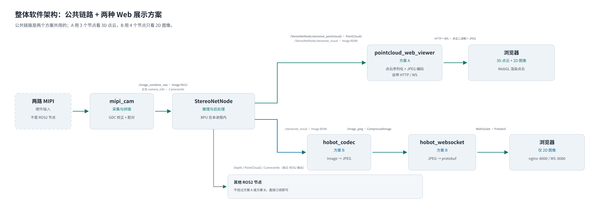
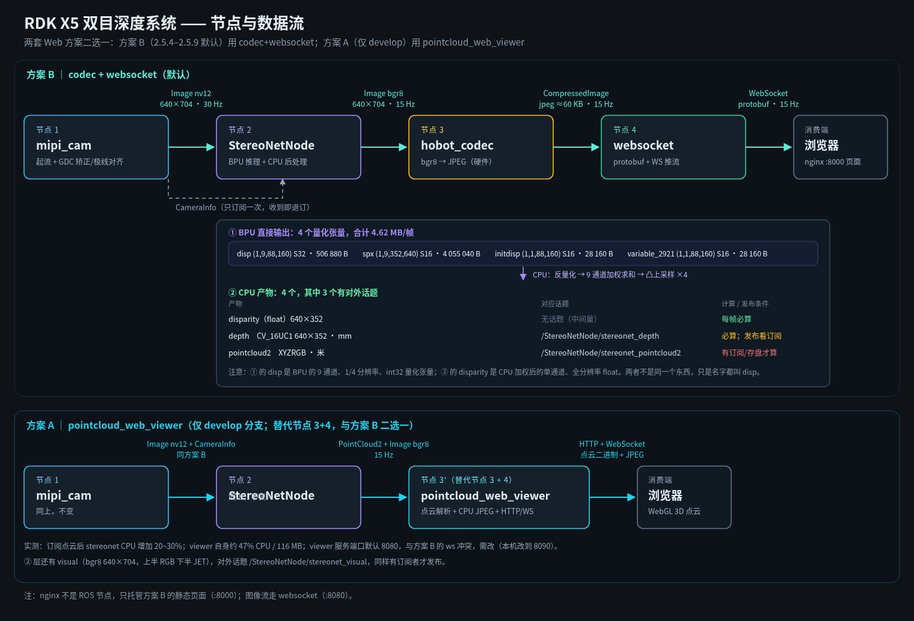
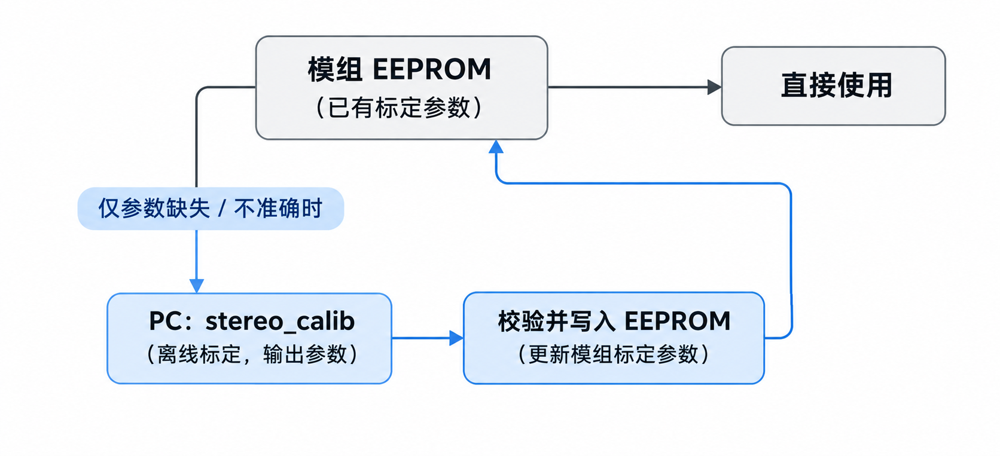
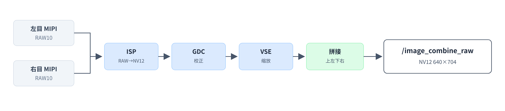
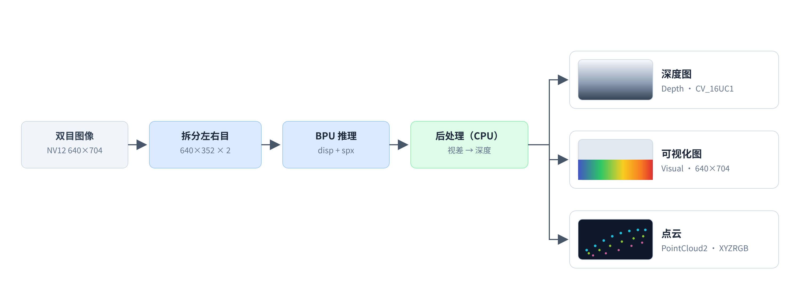

# X5 双目深度链路：从 MIPI 到 WebSocket

> 来源：飞书文档《X5 双目深度链路：从 MIPI 到 WebSocket》
> <https://horizonrobotics.feishu.cn/docx/OHSzdPn7TowBchxCMvccyuNFnEd>，2026-11-02 转换为 Markdown；
> 2026-11-03 第 1 章多轮改版后，全文整体重写为当前版本：第 1–4 章（架构 / 标定 / mipi_cam / StereoNetNode），
> 第 4 章止于「要点」。原第 5–7 章（codec 与 websocket 逐级字节、待验证清单、复现命令）随改写移除，
> 需要时可在本仓库历史提交 `ff178b8` 中找回。
> 图片经飞书文档素材接口下载后存放于 [`images/`](images/)。

## 1. 整体软件架构

`mipi_cam` 与 `StereoNetNode` 构成公共链路；方案 A 用 `pointcloud_web_viewer` 展示 3D 点云和 2D 图像，方案 B 用 `hobot_codec` + `hobot_websocket` 展示 2D 图像（本文实测为方案 B）。

> **补充图（非飞书原文）**：同一套链路的节点与数据流总览。相对上图，它额外标出 BPU 4 个量化张量的字节数、CPU 产物到对外话题的对应关系，以及方案 A 的实测开销（订阅点云后 `StereoNetNode` CPU 增 20–30%，viewer 自身约 47% CPU / 116 MB）。

| 发布者 | 订阅者 | Topic | 消息类型 |
|-|-|-|-|
| `mipi_cam` | `StereoNetNode` | `/image_combine_raw` | `Image`（NV12） |
| `mipi_cam` | `StereoNetNode` | `/image_combine_raw/left/camera_info`、`/image_combine_raw/right/camera_info` | `CameraInfo` |
| `StereoNetNode` | `pointcloud_web_viewer`（A） | `/StereoNetNode/stereonet_pointcloud2` | `PointCloud2` |
| `StereoNetNode` | `pointcloud_web_viewer`（A）、`hobot_codec`（B） | `/StereoNetNode/stereonet_visual` | `Image`（BGR8） |
| `hobot_codec` | `hobot_websocket`（B） | `/image_jpeg` | `CompressedImage`（JPEG） |

`StereoNetNode` 还发布 `/StereoNetNode/stereonet_depth`（`Image`，mono16）等独立 ROS2 输出；Web 浏览器数据通过 HTTP / WebSocket 传输。

## 2. 标定

**正常情况下无需重新标定。**双目模组通常已在 EEPROM 中存有标定参数（K、D、R、T）；X5 读取后，用于 GDC 立体校正和深度计算。

**仅当 EEPROM 中的参数缺失或不准确时**，才采集未校正的双目图像，在 PC 上使用 [stereo_calib](https://github.com/D-Robotics/stereo_calib) 离线解算并校验标定参数，再通过适配模组的烧录流程写入 EEPROM。`stereo_calib` 负责解算，不负责直接烧录 EEPROM。

## 3. mipi_cam

将两路 MIPI RAW10 图像完成校正与缩放，输出一张上下拼接的 NV12 图像供 StereoNet 使用。

### 3.1 处理链路

| 阶段 | 作用与输出（单目） |
|-|-|
| ISP | RAW10 → NV12，1088 × 1280 |
| GDC | 双目校正（去畸变、极线校正），1280 × 1088 |
| VSE | 缩放至 640 × 352 |

### 3.2 关键输出

| Topic | 类型 | 格式 / 尺寸 | 说明 |
|-|-|-|-|
| /image_combine_raw | sensor_msgs/msg/Image | NV12 / 640 × 704 | 双目拼接（上左下右） |
| /image_combine_raw/left/camera_info | sensor_msgs/msg/CameraInfo | — | 左目相机参数 |
| /image_combine_raw/right/camera_info | sensor_msgs/msg/CameraInfo | — | 右目相机参数 |

### 3.3 运行模式

| stream_mode | 处理链路 |
|-|-|
| 0（推荐） | ISP → GDC → VSE（本项目使用） |
| 1 | ISP → VSE → GDC（适用于需要输出子码流的场景） |

## 4. StereoNetNode

StereoNetNode 接收双目图像，使用 BPU 推理并在 CPU 上恢复视差、计算深度，输出深度图、可视化图和点云。

**要点**

- BPU 输出视差相关张量（disp、spx），CPU 加权恢复视差。
- 结合标定参数将视差转换为深度。
- 可视化图为左目图像与伪彩色视差图上下拼接。
