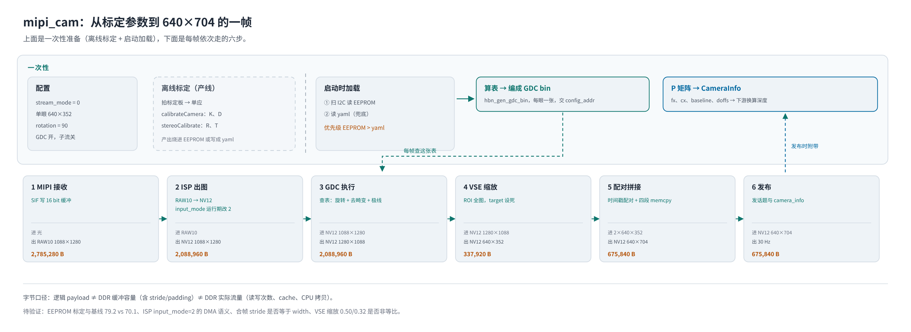
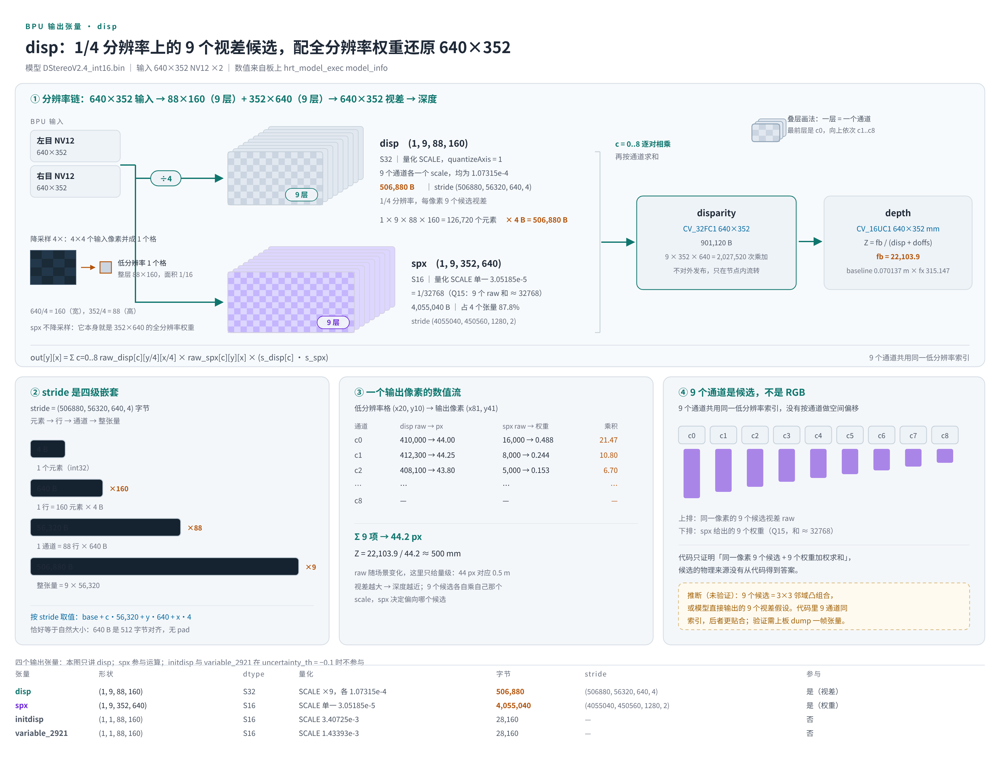
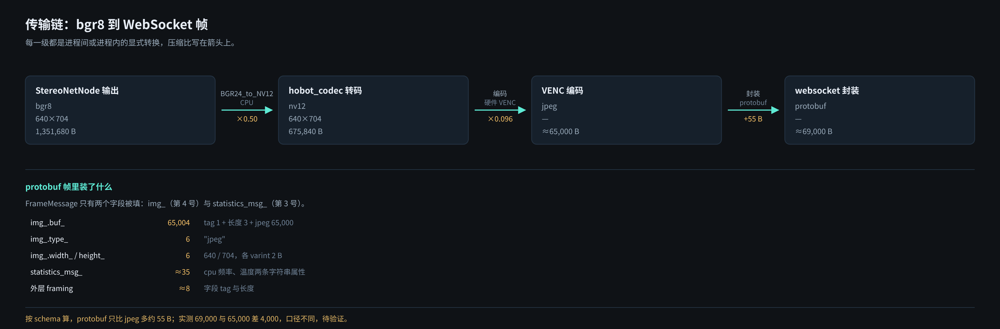

# X5 双目深度链路：从 MIPI 到 WebSocket

> 来源：飞书文档《X5 双目深度链路：从 MIPI 到 WebSocket》
> <https://horizonrobotics.feishu.cn/docx/OHSzdPn7TowBchxCMvccyuNFnEd>，2026-11-02 转换为 Markdown；
> 2026-11-03 同步第 1 章三次改版：结构由「四个进程」→「整体软件架构 / 节点接口 / 两种 Web 展示方案」，
> 节点接口表合并为 5 列，1.2 改为 A/B 对比表，开头环境与板况两段移入第 6、7 章；图 1 三次换版。
> 图片经飞书文档素材接口下载后存放于 [`images/`](images/)。

## 1. 整体软件架构

公共部分是 `mipi_cam` 和 `StereoNetNode`：前者把两路 sensor 拼成一张图，后者拆图推理出视差、深度和点云。之后在「怎么送到浏览器」这一步分成两种方案——方案 A 用 `pointcloud_web_viewer`（3 个节点，浏览器能看 3D 点云和 2D 图像），方案 B 用 `hobot_codec` + `hobot_websocket`（4 个节点，浏览器只能看 2D 图像）。

本文档记录的是方案 B（TROS 3.5.0 + DStereoV2.4_int16）；当前 develop 的 `stereonet_model_web_visual.launch.py` 里 `enable_web_viewer` 默认 True，起的是方案 A。

### 1.1 节点接口

| Node | 方案 | 职责 | 输入（Topic · 类型） | 输出（Topic · 类型） |
|-|-|-|-|-|
| `mipi_cam` | A、B | 采集、GDC 校正、配对拼接 | 两路 MIPI sensor（RAW10，硬件输入） | `/image_combine_raw`（Image / NV12）、左右 `camera_info`（CameraInfo） |
| `StereoNetNode` | A、B | 推理、后处理、发布 | `/image_combine_raw`（Image）、左右 `camera_info` | `stereonet_visual`（Image / BGR8）、`stereonet_depth`（Image / mono16）、`stereonet_pointcloud2`（PointCloud2）、`camera_info` |
| `pointcloud_web_viewer` | A | 点云序列化、JPEG 编码、HTTP / WS 服务 | `stereonet_pointcloud2`（PointCloud2）、`stereonet_visual`（Image） | HTTP + WebSocket（网络数据，非 Topic） |
| `hobot_codec` | B | 可视化图像编码为 JPEG | `stereonet_visual`（Image / BGR8） | `/image_jpeg`（CompressedImage） |
| `hobot_websocket` | B | JPEG 封装成帧并推送 | `/image_jpeg`（CompressedImage） | WebSocket（protobuf，非 Topic） |

表里除 `/image_combine_raw`、`/image_jpeg` 外，其余 Topic 都在 `/StereoNetNode/` 命名空间下，这里省略了前缀。五种 Node 不同时启用：A 起 3 个、B 起 4 个；传感器、BPU、浏览器、nginx 都不是 ROS2 节点。

本表只列主要接口，不是全部：`mipi_cam` 在 `dual_combine=1` 时还发 `/image_left_raw`、`/image_right_raw`，`StereoNetNode` 还发左右校正图，这些都放在各节点章节。

本方案的尺寸：合帧 NV12 640×704（每眼 640×352），`visual` 为 BGR8 640×704，深度 16 位 640×352。这些是本次配置，不是组件的固定要求。

### 1.2 两种 Web 展示方案的区别

| 比较项 | 方案 A | 方案 B |
|-|-|-|
| Web 展示节点 | `pointcloud_web_viewer` | `hobot_codec` + `hobot_websocket` |
| ROS2 节点总数 | 3 | 4 |
| Web 展示能力 | 3D 点云 + 2D 图像 | 仅 2D 图像 |
| 浏览器收到的数据 | 自定义点云二进制 + JPEG | JPEG 经 Protobuf 封装 |
| JPEG 编码 | Viewer 内部 OpenCV `cv::imencode()` | X5 的 JPEG 编码路径 |
| Web 服务 | Viewer 内置 HTTP / WebSocket | nginx 提供静态页，WebSocket 节点推送 |

方案 A 订阅 `stereonet_pointcloud2` 和 `stereonet_visual` 两路：点云转成自定义二进制给浏览器做 WebGL 渲染，图像用 `ImageCodec` 软件编码成 JPEG，不依赖 `hobot_codec`。方案 B 只订阅 `stereonet_visual`，点云不进这条 Web 链路，所以浏览器只能看 2D；`StereoNetNode` 仍提供点云接口，其他节点可以按需订阅。

端口：A 的 HTTP 与 WebSocket 通常都在 8080；B 的静态页在 8000、WebSocket 在 8080。并行启动时要避免冲突。


> **补充图（非飞书原文）**：同一套链路的节点与数据流总览。相对上面的架构图，它额外标出 BPU 4 个量化张量的字节数、CPU 产物到对外话题的对应关系，以及方案 A 的实测开销（订阅点云后 `StereoNetNode` CPU 增 20–30%，viewer 自身约 47% CPU / 116 MB）。


## 2. 标定

标定离线做，产出 K/D/R/T；启动时这些参数被编成 GDC 每帧要查的 bin，同时发布成 `CameraInfo`。


- **采集**：板上关矫正起流（`--mipi_gdc_enable False`，旋转保留），`/image_combine_raw` 是 1280×2176（上左下右），至少 20 对，覆盖中心、四角、±30° 倾斜，停稳再拍。
- **解算**：PC 上跑 `stereo_calib` 的 `calib.py`；`--row`/`--col` 填内角点数，`--block_size` 填实测格子边长，`--model` 把 pinhole、fish、mei 都试一遍取误差最小的。
- **判定**：重投影误差 < 0.5，并且 `rectify_*` 里直线拉直、`epipolar_alignment_*` 里同一物点在同一行；图不对就重拍。
- **产出**：`stereo_opencv_pinhole.yaml`，键名与 mipi_cam 的标定文件一致（`left_camera_matrix`、`R`、`T` 等）。
- **去向一（几何）**：参数算成源坐标映射，按 50×50 分块编成 GDC bin，经 `config_addr` 交给 GDC 节点；也可以用 `mipi_gdc_bin_file` 直接加载现成的 bin。
- **去向二（数值）**：P 矩阵发布成 `CameraInfo`，下游用它把视差换成米。
- **来源优先级**：启动时优先读模组 EEPROM；yaml 只在 EEPROM 没有标定时用于 `CameraInfo`，**不参与 GDC 建表**。

自检：日志出现 `X5 start gdc rotation and cal.`；对着标定板看方格是否仍正方、极线是否水平；`camera_info` 的 `fx`、`baseline` 与 yaml 对得上。

## 3. mipi_cam

输入两路 RAW10 1088×1280，输出一张 nv12 640×704，675,840 B，30 Hz；起流前把第 2 章的表加载进来，之后每帧走六步。



- **查表**：GDC 每帧按第 2 章编好的 bin 取源，旋转、去畸变、极线一次做完，CPU 不参与。
- **谁在缩小**：GDC 只换宽高，真正把面积压到 1/6.18 的是 VSE；VSE 横纵缩放比不一致（0.50 / 0.32），要么非等比压缩、要么 bin 里已裁过，待验证。
- **拼接是四段**：`左Y｜右Y｜左UV｜右UV`，UV 只有 Y 的一半高；配对靠软件时间戳，超差丢旧帧。
- **变体**：`run_cam.sh` 用 `stream_mode=1`，把 GDC 拆成两级、并在中间用 VSE 分出子流给 VIO；该脚本 `rotation=0`，没有旋转级。
- **字节口径**：上面所有字节都是逻辑 payload，不能当 DDR 缓冲容量或实际流量用。

自检：日志有 `rotation and cal.`、话题宽高 640/704、`topic bw` 约 20 MB/s。

## 4. StereoNetNode

节点从 `/image_combine_raw` 拿一张 640×704，拆成两路送 BPU，取回 4 个量化张量，后处理成视差再转深度、点云和可视化。BPU 在本进程内。



### 4.1 推理

推理这一步做的事很直接：把一张上下拼接的图拆成左右两半，分别送进模型，等模型算完拿回结果。

拆法是按行切：上半张是左目，下半张是右目，每半 640×352。

模型能接受的尺寸是固定的，写在所用的 bin 里（现在这个 bin 是 640×352）。所以相机输出的图（mipi_cam 的 `image_width/height`）要设成同样的值：640×704 的拼图拆开正好是 640×352，不用额外处理。换一个别的尺寸的 bin，就要把相机输出尺寸一起改。

不改的话程序会先缩放一次再推理——能跑，但多一道缩放，精度会略降。

两个参数顺带一提：`infer_thread_num` 控制并行线程数，超过 4 会被压回 4；`uncertainty_th` 是置信度阈值，本脚本传 −0.10，等于把置信度过滤关掉。

### 4.2 四个张量输出

| 张量 | 形状 | dtype | 量化 | 字节 |
|-|-|-|-|-|
| `disp` | (1, 9, 88, 160) | S32 | SCALE ×9，各 `1.07315e-4` | 506,880 |
| `spx` | (1, 9, 352, 640) | S16 | SCALE `3.05185e-5`（1/32768） | 4,055,040 |
| `initdisp` | (1, 1, 88, 160) | S16 | SCALE `3.40725e-3` | 28,160 |
| `variable_2921` | (1, 1, 88, 160) | S16 | SCALE `1.43393e-3` | 28,160 |

- `disp`：1/4 分辨率下每个像素的 9 个视差候选，4 字节定点；后处理时加权求和，不直接输出。
- `spx`：全分辨率的 9 个权重，Q15 定点，决定每个输出像素偏向哪个候选；它比 disp 大 8 倍，就是为了保住这个分辨率。
- `initdisp`：粗视差，开置信度时拿来和主视差比较。
- `variable_2921`：开置信度时与 `initdisp` 成对使用，作为这一对的权重；当前关着用不到。这条分支把 88×160 的结果直接和 352×640 的主视差相减，尺寸对不上，能否跑通没验证过。

合计 4,618,240 B，是输入的 6.83 倍——这是按 validShape 算的有效数据量，不等于 stride 对齐后的实际内存占用。

### 4.3 后处理

当前配置下四个张量只有 `disp` 和 `spx` 参与：CPU 按各自的量化 scale，做 4 倍空间映射的加权求和，得到 352×640 的浮点视差。`initdisp` 与 `variable_2921` 在这条主路径上用不到。

公式是 `out += disp[c][y/4][x/4] × spx[c][y][x] × (s_disp[c]·s_spx)`，共 2,027,520 次 MAC，输出 CV_32FC1（901,120 B）。

### 4.4 四路输出

| 话题 | 格式 | 字节 | 何时构建 |
|-|-|-|-|
| `~/stereonet_depth` | CV_16UC1 640×352 | 450,560 | 有订阅者 |
| `~/stereonet_visual` | bgr8 640×704 | 1,351,680 | 有订阅者 |
| `~/stereonet_pointcloud2` | XYZRGB 56,021 点 | 1,792,672 | 按需 |
| `camera_info` | sensor_msgs | 几百 B | 每次发布 |

- **visual 画的是视差，不是深度**：先按 `render_type` 定显示范围（distance 模式取深度的 2% 分位当最近点），再对 352×640 的视差做 JET 上色，最后与左目 `vconcat` 成 640×704。
- **点云**是深度 + 左目颜色的反投影，跳过无效深度和 5 m 以外的点，每 2×2 取一个。
- **camera_info 不转发原始标定**：节点按 `fx/cx/fy/cy/baseline` 重新构造 K、P、R；右目那份把 `p[3]` 设成 `−baseline×fx`。
- 频率：30 fps 进、15 Hz 出——输入队列恒为 1，新帧丢未处理的旧帧。

### 4.5 深度

`z = fb/(d + doffs)`，`fb = baseline × fx × 1000 = 22,103.9`；`d ≤ 0` 置 0，上限 clamp 到 65535，输出 CV_16UC1（mm）。参数取自 `image_combine_raw` 的 `camera_info` P 矩阵，来历见第 2 章。

## 5. hobot_codec 与 hobot_websocket

codec 把 1,351,680 B 的 bgr8 压到约 65,000 B 的 jpeg，websocket 再封装成 protobuf 帧推出去。

### 5.1 hobot_codec

| 步骤 | 函数 | 参数 | 字节 | 源码位置 |
|-|-|-|-|-|
| 订阅 | — | `sensor_msgs/Image`，bgr8，640×704 | 1,351,680 | 已上板实测 |
| 转 NV12 | `video_utils::BGR24_to_NV12` | CPU 软转，硬件只做编码 | → 675,840 | `hobot_codec_node.cpp:571` |
| 编码 | `MEDIA_CODEC_ID_JPEG` | `quality_factor = jpg_quality`（板上 60），`bitstream_buf_size` 按 4096 对齐 | → ≈65,000 | `encoder/x5/hobot_venc.cpp:399` |
| 发布 | — | `CompressedImage`，`format="jpeg"`，stamp 取帧时间戳 | ≈65,000 | `:892` |

这一跳有两次变换：bgr8 → nv12（CPU）→ jpeg（硬件 VENC）。编码器不收 bgr8，NV12 是必需的中间态。

jpeg 大小由质量和画面内容共同决定，源码里没有码率上限，只有 `quality_factor`，所以 65,000 B 是典型值不是定值。

### 5.2 hobot_websocket

| 步骤 | 函数 | 参数 | 字节 | 源码位置 |
|-|-|-|-|-|
| 入队 | — | `x3_frames_` 上限 100，超出丢最旧并告警 | 队列内 ≈65,000/帧 | `websocket.cpp:294-310` |
| 取宽高 | `cv::imdecode(IMREAD_UNCHANGED)` | 只为拿 `img_w`、`img_h`，把整帧解码一遍 | — | `:572` |
| 填 protobuf | — | `img_.buf_` 原样拷贝 jpeg，`type_="jpeg"`，`width_`/`height_` | ≈65,000 | `:579-583` |
| 附系统信息 | — | `statistics_msg_` 里两条字符串：cpu 频率、温度 | ≈35 | `:592-620` |
| 发送 | — | `SerializeToString` 后直接 WS 发送，15 Hz | ≈69,000 | `:634-641` |

`imdecode` 这一行只为了 `img_w`/`img_h` 两个整数，等于每帧多解码一次 jpeg；宽高本来可以从 `CompressedImage` 的来源帧拿，现在没拿。多花的 CPU 时间未测。

### 5.3 protobuf 帧的字节构成

`FrameMessage` 有 4 个字段，实际只填 `img_`（第 4 号）和 `statistics_msg_`（第 3 号）。

| 字段 | 字节 | 说明 |
|-|-|-|
| `img_.buf_` | 65,004 | tag 1 + 长度 3 + jpeg 65,000 |
| `img_.type_` | 6 | `"jpeg"` |
| `img_.width_` / `height_` | 6 | 640 / 704，各 varint 2 B |
| `statistics_msg_` | ≈35 | cpu、temp 两条字符串属性 |
| 外层 framing | ≈8 | 字段 tag 与长度 |
| 合计 | ≈65,060 | 比 jpeg 多约 55 B |

按 schema 算，protobuf 封装只多约 55 B。但实测 jpeg 话题约 65,000 B、WS 帧约 69,000 B，差 4,000 B 用 schema 解释不了，两者测量口径不同（话题带宽与 WS 帧大小、是否同一帧），待验证。

### 5.4 每级格式与字节

| 级 | 格式 | 尺寸 | 字节/帧 | 压缩比 |
|-|-|-|-|-|
| visual | bgr8 | 640×704 | 1,351,680 | — |
| nv12 | NV12 | 640×704 | 675,840 | ×0.50 |
| jpeg | 字节流 | — | ≈65,000 | 相对 nv12 ×0.096 |
| protobuf | 字节流 | — | ≈69,000 | 相对 jpeg ×1.06（≈55 B 封装） |

### 5.5 方案 A：pointcloud_web_viewer

`pointcloud_web_viewer`（仅 develop）用单个进程替代 codec 与 websocket：自己收点云和可视化、CPU 编码 JPEG（`image_quality=40`）、自带 HTTP/WS 服务，协议是 20 B/点加 24 B 头的紧凑格式，不走 protobuf。两套方案的 8080 端口冲突，只能二选一。



## 6. 待验证

板 192.168.1.15 从 10 月 28 日起 ping 不通，下面这些项没法上板核实；其中硬件流水线、拆图与丢帧只有源码依据。

| 位置 | 待验证项 | 方法 |
|-|-|-|
| 3.1 | 现场实际 `stream_mode`、`rotation`、`cal_rotation`、`gdc_enable`、`sub_stream_enable` | `ros2 param get /mipi_cam stream_mode` 等 |
| 3.2 | ISP `input_mode=2` 与 `cim_isp_flyby=1` 的最终 DMA 语义（是否经 DDR） | 查该版本 SDK 手册；运行时寄存器或抓帧 |
| 3.3 | 子码流的实际消费者与 544×640 的用途 | 看部署脚本与下游节点 |
| 2 | 板端 EEPROM 标定是否被认到；yaml 与 EEPROM 的基线差异（79.2 vs 70.1 mm） | 读 `camera_calibration_file_path`；对比 `CameraInfo` 的 K/P |
| 2 | 立体校正后的实际有效视场与裁剪 | 校正后拍标定板看重投影误差与覆盖区；remap 内部无法从宽高比反推 |
| 3.2 | 合帧时捕获缓冲 stride 是否等于 width | 抓帧看 `width/height/step/size` |
| 3.2 | 物理哪只镜头在上半张 | 遮住一只镜头看哪个半张变黑 |
| 3.2 | 两路时间戳实际差值（软配对效果） | 抓 100 帧比对两路 stamp |
| 4.2 | 单帧耗时分解（推理 vs 后处理）与实际丢帧率 | `ScopeProcessTime` 日志；回调计数与发布计数对比 |
| 4.3 | `spx` 9 通道来源（3×3 邻域还是 9 个假设） | dump 一帧 4 个张量，看第 c 通道是否为第 0 通道平移 |
| 4.7 | `doffs` 取值与来源 | `ros2 topic echo /image_combine_raw/right/camera_info` 看 `P[3]`，对比 yaml |
| 4.8 | 点云点数随场景的波动 | 连抓 100 帧 `pointcloud2` 的 `width` |
| 5.1 | jpeg 大小分布 | 抓 100 帧 `CompressedImage.data.size()` |
| 5.2 | `imdecode` 只为取宽高的额外 CPU 开销 | perfetto 打点 `FrameAddImage`；或改成从来源帧取宽高后对比 |
| 5.3 | 实测 jpeg 65,000 与 WS 69,000 差 4,000 B 的口径 | 同一帧同时抓话题与 WS 帧，比较字节 |

上板注意：反复 kill cam-service 后 ISP 资源可能不释放（`ISC_IOCTL_BIND fail`），需重启板；`/usr/hobot` 只读，写库前 `mount -o remount,rw /usr/hobot`。

## 7. 复现命令

环境：RDK X5 + SC132GS 双目模组，TROS 3.5.0（stereonet 2.5.6、mipi-cam 2.5.2、codec 2.3.5），模型 DStereoV2.4_int16，30 fps。

```bash
ros2 topic echo /image_combine_raw --once --field width
ros2 topic hz /image_combine_raw && ros2 topic bw /image_combine_raw

bash /opt/tros/humble/share/hobot_stereonet/script/run_stereo.sh --mipi_rotation 0.0 2>&1 \
  | grep -A12 "stetreo calibration"

hrt_model_exec model_info --model_file \
  /opt/tros/humble/share/hobot_stereonet/config/DStereoV2.4_int16.bin

ros2 param get /StereoNetNode uncertainty_th        # -0.1
ros2 param get /StereoNetNode infer_thread_num      # 2
ros2 param get /hobot_codec_encoder_{id} jpg_quality # 60.0

ros2 topic bw /StereoNetNode/stereonet_visual
```
