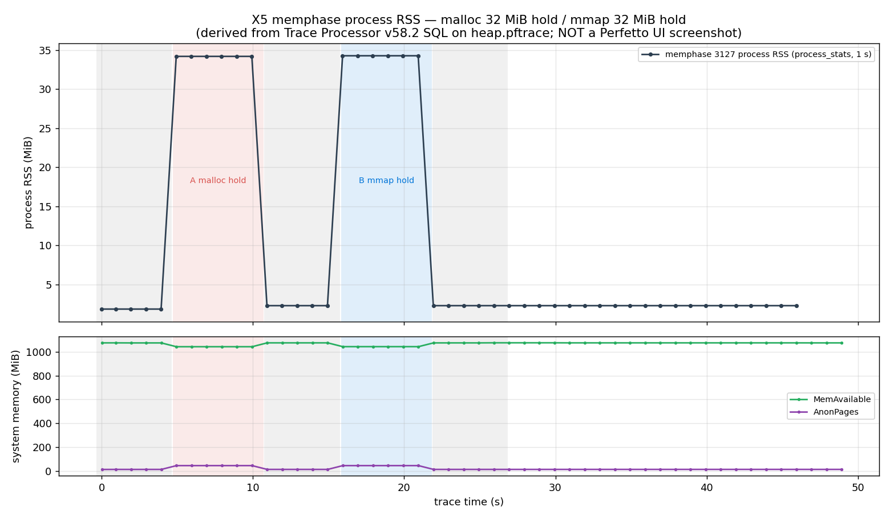

# VISUAL_REPORT — X5 内存场景第二次验证（perfetto-memory-debugging v1.0.2）

日期：2026-10-17
场景：独立 ARM64 测试进程，`malloc(32 MiB)` 阶段 + 直接 `mmap(32 MiB)` 阶段，单份联合 Trace。
采集：X5 板端 tracebox / heapprofd preload **v57.1-c59f57dd4**（ARM64）
分析：Ubuntu 主机 Trace Processor **v58.2-add693d8b**
UI：https://ui.perfetto.dev/（stable v58.3，headless Chrome 实测打开）

---

## 0. 结论

| 验收项 | 结论 | 依据 |
|---|---|---|
| 数据采集 | **PASS** | 单份 trace 同时含 process RSS、系统内存计数器、`kmem/rss_stat`、heapprofd；4 个数据源全部 seen；traced buffer 丢弃 0；ftrace overrun 0 |
| RSS 时间线 | **PASS** | 1 s 进程 RSS：baseline 1.867 → A hold 34.191 → idle 2.305 → B hold 34.270 → idle 2.305 MiB；两段 +32 MiB 平台与程序日志/系统计数器一致 |
| Native 分配归因 | **PASS** | heapprofd 精确记录 +33,554,432 B（32 MiB）；调用栈 `phase_a → main → __libc_start_main → _start`，`malloc` 帧来自 preload；与程序 malloc 量、时序一致 |
| malloc / mmap 覆盖差异 | **PASS** | malloc 阶段有 1 正 1 负分配记录；直接 mmap 阶段 heapprofd 记录 0 行，但 RSS/AnonPages 同期上涨 32 MiB → 覆盖差异成立 |
| Perfetto UI 展示 | **UNKNOWN** | 真实 trace 已在 ui.perfetto.dev 打开（截图 1 张），但展开进程轨道 / 火焰图 / SQL Debug Track 的自动化不可靠，按指示停止重试；未获得两张关键视图 |

> v57.1 采集器不提供 dump 窗口起点（`dur=0`）**没有**被用来否定任何总量、归因或 RSS 结论；它只影响“持有区间”这一项，单独标为不可判。

---

## 1. 冻结版本与环境

| 项 | 值 |
|---|---|
| 冻结候选 | `v2_modify/candidate-v1.0.2/` @ `0fa17e08eb8b93a9944232e380c7ddb39666fcf2` |
| 候选完整性 | 工作树 clean；candidate 目录相对冻结 commit 无 diff；资源预检 33 个必需文件 + 10 个 config 可读 |
| 板卡 | `Linux buildroot 6.1.83-DR-PL5.1_V1.0.20 aarch64`，8 core，MemTotal 1,336,028 kB |
| tracefs | `/sys/kernel/debug/tracing`，1170 个事件，含 `kmem:rss_stat`、`sched:sched_switch` |
| 采集器 | tracebox `v57.1-c59f57dd4`（SHA-256 `58f44bbb…8c57f3`） |
| preload | `libheapprofd_glibc_preload.so` `v57.1`（SHA-256 `d8fde29c…7c417c1`） |
| 主机分析器 | Trace Processor `v58.2-add693d8b` |
| 会话脚本 | 冻结版 `scripts/linux_heapprofd_session.sh`，**未修改**（副本在 `scripts/frozen/`） |
| 观测时长 | `OBSERVE_S=45`，config `duration_ms=90000`（满足脚本 `+30 s` 余量要求） |

---

## 2. 采集设计：单份联合 Trace

用冻结版 `make_config.py native` 生成基础配置（`--process memphase --sampling 4096 --dump-ms 5000 --shmem-kb 8192`），再手工追加一个 `linux.ftrace` 数据源采集本板真实存在的 `kmem/rss_stat`（`make_config.py` 的 `native` 场景本身不含 ftrace）。**这是调用方配置扩展，冻结 Skill 未改动。**

| 数据源 | 参数 | 作用 |
|---|---|---|
| `linux.process_stats` | `proc_stats_poll_ms=1000`, scan_all | 目标进程 `/proc` RSS（`mem.rss`）与线程信息 |
| `linux.sys_stats` | meminfo/vmstat 1000 ms | 系统内存计数器（MemAvailable/AnonPages/CMA…） |
| `linux.ftrace` | `kmem/rss_stat`, buffer 2048 KiB/CPU, drain 250 ms | 目标 mm 的 anon/file/shmem RSS ftrace 事件 |
| `android.heapprofd` | `sampling_interval_bytes=4096`, `process_cmdline="memphase"`, shmem 8 MiB, continuous dump 5000 ms, `block_client:false` | Native 堆分配与调用栈 |

Buffer 预算：8 MiB + 4 MiB + 32 MiB + ftrace 2 MiB×8 CPU，合计约 60 MiB；板端 `/data` 为 tmpfs，trace 输出 89,233 B。

程序（`src/memphase.c`）：baseline 5 s → A `malloc 32 MiB` 逐页写入、保持 6 s、free → idle 5 s → B `mmap(MAP_PRIVATE|MAP_ANONYMOUS) 32 MiB` 逐页写入、保持 6 s、munmap → idle 5 s → tail 保活。阶段边界以 `CLOCK_BOOTTIME` 写入日志，与 trace `ts` 同钟。

---

## 3. 数据采集验收

| 检查 | 结果 | 证据 |
|---|---|---|
| Trace 可解析 | PASS | TP v58.2 正常加载，trace_bounds `30385076047696 → 30434027803845`，**48.952 s** |
| 目标 UPID | PASS | **UPID 186 / pid 3127**（`./memphase`），有 native 数据；UPID 188 / pid 3130 是 preload fork 的 heapprofd 辅助子进程（同名，0 行），不选 |
| 数据源 | PASS | `traced_data_sources_seen = 4`；四类数据均可查（见下） |
| 进程 RSS | PASS | `mem.rss` 47 个 1 s 采样，1.867–34.270 MiB |
| 系统内存 | PASS | MemAvailable 50 个采样，1043.836–1076.805 MiB |
| RSS ftrace | PASS | `kmem/rss_stat` 879 条事件；目标进程展开为 372 个事件级采样，峰值 total 34.305 MiB、anon 32.207 MiB |
| Native heap | PASS | `heap_profile` 1 行（`dur=0`）；`heap_profile_allocation` 2 行（±32 MiB） |
| 数据丢失 | PASS（无记录丢失） | traced buffer `chunks_discarded=0`，`bytes_written == bytes_read`；`ftrace_cpu_overrun_*=0`、`commit_overrun_*=0`；heapprofd `client_disconnected=1`（正常收尾） |

补充（如实记录，不影响结论）：

- 程序启动时间 30384706001155 略早于 trace 首个事件 30385076047696（差 0.37 s），但所有分配与两个阶段都落在 trace 内。
- 程序写入的 ftrace `trace_marker` **没有**被 v57.1 tracebox 的 ftrace 数据源收进 trace（`raw` 表只有 `rss_stat`）。因此阶段对齐全部使用 `CLOCK_BOOTTIME` 日志，不使用 trace_marker。
- tracefs 环形缓冲区在会话开始前并非空（部分 CPU 上有约 42 分钟前的旧事件），但解析出的 `raw` 最小 `ts` = 30385093643238，仍在 trace 窗口内；未把窗口外旧事件计入。

---

## 4. RSS 时间线

### 4.1 进程 RSS（linux.process_stats，1 s）

阶段边界来自 `traces/memphase.log`。单位 MiB。

| 阶段 | 采样数 | min | max | 说明 |
|---|---|---|---|---|
| baseline | 5 | 1.867 | 1.867 | malloc 前基线 |
| A malloc hold | 6 | 34.191 | 34.191 | +32.324 MiB |
| A idle | 5 | 2.305 | 2.305 | free 后回落 |
| B mmap hold | 6 | 34.270 | 34.270 | +31.965 MiB |
| B idle | 5 | 2.305 | 2.305 | munmap 后回落 |

程序自记 VmRSS（旁证）：baseline 1912 KiB = 1.867 MiB；A hold 35,012 KiB = 34.191 MiB；A free 后 2360 KiB = 2.305 MiB；B hold 35,092 KiB = 34.270 MiB；munmap 后 2360 KiB。**与 trace 1 s 采样逐点一致。**

### 4.2 RSS ftrace（kmem/rss_stat）

目标进程 372 个事件级采样，时间范围 30385076047696–30431518160885。anon 在 touch 期间从 0.191 MiB 阶梯上升到 32.207 MiB；每步约 0.258 MiB（内核计数器批量更新触发，**不是逐页**）。峰值 total 34.305 MiB。free 后 anon 回落并在进程退出时归零。

这一点与 Skill 口径一致：`rss_stat.size` 是当时的绝对量，可用来看“何时变化、变化多少”，不能当成逐页/逐次 malloc 日志。

### 4.3 系统内存计数器（1 s）

| 计数器 | min | max | 变化 |
|---|---|---|---|
| MemAvailable | 1043.836 | 1076.805 | −32.97 MiB（两段各约 −33） |
| AnonPages | 11.590 | 43.984 | +32.39 MiB |
| MemFree | 957.137 | 990.105 | −32.97 MiB |

### 4.4 曲线



> 该图由 `sql_out/rss_process_1s.csv` + `sql_out/sys_mem_1s.csv` 绘制，**不是 Perfetto UI 截图**；用于在 UI 不可用时仍能检查两段平台与阶段顺序。

RSS 曲线可以看到两个清晰的 32 MiB 平台，阶段顺序与程序日志一致：baseline → A（malloc）→ idle → B（mmap）→ idle。malloc 与 mmap 两条路径在 RSS 上表现相同，这正是需要 Native 归因来区分的原因。

---

## 5. Native 分配归因（heapprofd）

### 5.1 采集到的记录

`heap_profile`（UPID 186, heap `libc.malloc`）：

| ts | ts_end | dur | 说明 |
|---|---|---|---|
| 30389714144908 | 30389714144908 | **0** | v57.1 不提供窗口起点，窗口塌缩为一点 |

`heap_profile_allocation`：

| ts | count | size (B) | size (MiB) |
|---|---|---|---|
| 30389714144908 | +1 | **+33,554,432** | +32.000 |
| 30389714144908 | −1 | **−33,554,432** | −32.000 |

- 分配字节与程序 `malloc(32 MiB)` **完全相等**。
- `count=1` 只因为该分配 32 MiB ≥ 采样间隔 4096 B，被必采（p=1），size 为精确值；这是大分配特例，不能外推成“记录了精确 malloc 次数”。小对象仍按字节采样并有方差。
- 两条记录的 `ts` 相同，是 dump 窗口结束时刻（`window_end`），**不是两次 malloc 的真实时间**，也不是 dump 的发出时间。

### 5.2 调用栈（`sql/04-native-callstacks.sql`）

| depth | 帧 | 模块 | cumulative_allocated |
|---|---|---|---|
| 0 | `_start` | `/data/perf102v2/app/memphase` | 33,554,432 |
| 1 | `__libc_start_main` | `/usr/lib/libc.so.6` | 33,554,432 |
| 2 | (未命名) | libc | 33,554,432 |
| 3 | `main` | memphase | 33,554,432 |
| 4 | **`phase_a`** | memphase | 33,554,432 |
| 5 | `malloc` | `libheapprofd_glibc_preload.so` | 33,554,432 |
| 6–8 | (未命名) | preload | 33,554,432 |

- 测试程序的 malloc 路径被正确归因到 `phase_a → main`，不是笼统的“进程总分配”。
- `cumulative_live_bytes_at_end = 0` 的原因是同一 `ts` 上先 +32 MiB 后 −32 MiB（净 0），不是“没有分配”。
- 未命名帧是 preload 内部帧（该 `.so` 已 strip）；不影响对 `phase_a/malloc` 的归因。若需要 libc/preload 内部符号，需另行准备 unstripped 版本。

### 5.3 实际 dump 数、dur 与可用时间信息

用 host `traceconv v58.2` 解开原始 packet（`logs/heapprofd_raw_dumps.txt`）：

| 项 | 值 |
|---|---|
| 采集器发出的 dump 数 | **9**（9 个 `process_dumps`，每份 `heap_samples=1`，与 `heapprofd_unwind_samples=9` 一致） |
| 各 dump 的内部时间戳 | **全部相同** 30389703749949（heapprofd 单调钟） |
| 窗口前进条件 | 只有“带非零 timestamp 的分配”推进；本场景 malloc 后 6 s 只持有、不新分配，free 不推进 → 窗口冻结 |
| 分析器可见 dump | **1**（v58.2 按 `(upid, window_end, heap_name)` 去重） |
| `dur` | **0**（v57.1 无 `start_timestamp`，`ts == ts_end`） |
| 可用的时间信息 | 仅 `window_end`（= 32 MiB 分配提交时刻，落在程序 malloc 调用后 **+4.212 ms**，在 `A_MALLOC_START..A_TOUCH_DONE` 内）；分配/释放**真实先后顺序可从 9 份旧 dump 的最后一份看到（self_freed 出现在第 9 份），但精确时刻不可判** |
| 最后一个 dump 包时间 | 30431519138469（≈ trace 结束前 2.5 s） |

结论：**dump 数少、dur=0 不等于采集失败**。总量、调用栈、分配/释放方向都有效；“32 MiB 持有了多久”在 v57.1 上不可判（UNKNOWN），只能给出上界/旁证（RSS 平台约 6 s，来自 1 s 采样与程序日志）。

---

## 6. malloc 与直接 mmap 的覆盖差异

### 6.1 机制证据

- `libheapprofd_glibc_preload.so` 的导出符号只有 malloc 家族：`malloc/free/calloc/realloc/reallocarray/memalign/posix_memalign/free_sized/...`；**没有导出 `mmap`/`munmap`**（`mmap64`/`munmap` 只是内部使用的未定义引用）。
- 因此默认 libc hook 覆盖 `malloc/new` 路径；直接 `mmap(MAP_PRIVATE|MAP_ANONYMOUS)` 不属于该 heap，heapprofd 不会把它记成 Native 分配。

### 6.2 实测对照（`sql/21-phase-coverage.sql`）

| 阶段窗口 | heapprofd 行数 | 正字节 | 负字节 |
|---|---|---|---|
| A: malloc 32 MiB `[30389709933199, 30395817772035]` | 2 | 33,554,432 | 33,554,432 |
| B: mmap 32 MiB `[30400822147912, 30406938280165]` | **0** | 0 | 0 |

同窗口内 RSS/AnonPages 明确上涨 32 MiB，所以 B 的 0 行是**覆盖差异**，不是“没有分配”。

另一个需要说明的口径：glibc 对 32 MiB 的 `malloc` 内部通常走 `mmap`，但 heapprofd 的 hook 点在 libc `malloc` 入口，归因对象是**调用 malloc 的路径**（`phase_a`），不是内核 mmap。不要把“malloc 内部用了 mmap”与“直接 mmap 被覆盖”混为一谈。

---

## 7. 程序记录 vs Trace 实测对照（`sql/23-crosscheck.sql`）

| 检查项 | 程序/期望 | Trace 实测 | 判定 |
|---|---|---|---|
| A malloc 字节 | 33,554,432 | heapprofd +33,554,432 | MATCH |
| A free 字节 | 33,554,432 | heapprofd −33,554,432 | MATCH |
| A 分配记录 count | 1（大分配 p=1） | 1 | MATCH（特例，非通用精度） |
| B 直接 mmap | 33,554,432 | heapprofd B 窗口 0 行 | 未覆盖（符合机制） |
| B RSS 上涨 | ~32 MiB | 31.965 MiB | MATCH（±2 MiB） |
| A RSS 上涨 | ~32 MiB | 32.324 MiB | MATCH（±2 MiB） |
| 分配记录时间 | malloc 调用 | window_end = malloc 后 4.212 ms | 在 malloc/touch 窗口内 |
| dump 数 | 采集器 9 | 分析器可见 1 | 去重（同 window_end、dur=0） |

阶段顺序也与程序日志一致：baseline → A malloc → A idle → B mmap → B idle → tail。

---

## 8. Perfetto UI

### 8.1 实际做了什么

- 用 **真实 headless Chrome** 打开 `https://ui.perfetto.dev/`（当前 stable v58.3），通过页面 **Open trace file** 上传本次真实 `traces/heap.pftrace`，成功打开一次并保存截图 `ui/ui_loaded_partial.png`。
- 截图中可见：当前 trace `heap.pftrace (1 MB)`；`Start: 08:26:25.076 047 696`、`Duration: 48s 951ms 756µs 149ns`（与 SQL `trace_bounds` 一致）；轨道列表含 `/memphase 3127`（目标）与 `/memphase 3130`（heapprofd 辅助子进程）；底部已出现 “Native heap profile” 面板。
- 尝试自动展开 `/memphase 3127`、定位 RSS 轨道、点击 heap profile slice 打开火焰图、以及 Query 页面创建 Debug Track；多次尝试中只有一次成功加载（8.2 MB 前端 bundle 与 wasm 在无外网加速的环境下不稳定），展开/点击未能可靠生效。按任务要求**停止重试**，不把部分截图当作完整验收。

### 8.2 结论

| UI 检查项 | 结论 |
|---|---|
| 能打开真实 trace 并识别目标进程 | 部分证据（1 张真实截图） |
| 进程 RSS 曲线能看到两个阶段 | **UNKNOWN** |
| 能定位对应时间区间 | **UNKNOWN** |
| Native Heap 火焰图含测试程序 malloc 路径 | **UNKNOWN** |
| SQL Debug Track 显示统计 | **UNKNOWN** |
| 图中数值与 SQL 一致 | **UNKNOWN**（未取得图表读数） |

**Perfetto UI 展示总评：UNKNOWN。** 这是本机无图形界面 + 前端资源加载不稳定造成的观测层限制，不是冻结 Skill 或 trace 数据的缺陷。

### 8.3 本地打开步骤与应检查项（可直接执行）

1. 打开 https://ui.perfetto.dev/ → **Open trace file** → 选择 `traces/heap.pftrace`。
2. 核对顶部：`Start` 对应 trace 起点，`Duration ≈ 48.952 s`；`traced_data_sources_seen=4`。
3. 展开 **`/memphase 3127`**（不是 3130）：
   - `mem.rss` 应呈两段平台：约 **1.87 → 34.19 → 2.31 → 34.27 → 2.31 MiB**；
   - 把鼠标移到约 **4.6 s / 14.7 s** 处，读数应与 `sql_out/02-rss-phase-summary.txt` 一致；
   - 若 1 s 采样不够细，用下面的 SQL 建 Counter Track 对照 `sql/01`。
4. **Native heap profile** 轨道：点击切片（本 trace 只有 1 个可见切片，位于 trace 时间 **≈ 4.638 s**，即 `ts=30389714144908`）。火焰图 Measure 选 **Unreleased Malloc Size**，搜索 `phase_a`。预期：
   - 栈顶路径 `phase_a → main → __libc_start_main → _start`，`malloc` 帧来自 preload；
   - 宽度 **32 MiB**（`33,554,432 B`）；
   - 由于同一 `ts` 上还有 −32 MiB，Unreleased 可能显示 0；此时切到 **Total Malloc Size** 看 +32 MiB，或直接看 `sql/21` 的两行 Δ。
   - Snapshot 时间为 0 或只有一个点，属 v57.1 无窗口起点的已知行为（`dur=0`），不是采集失败。
5. **SQL Debug Track**（Query (SQL)）：

```sql
INCLUDE PERFETTO MODULE linux.memory.process;
SELECT ts, rss / 1048576.0 AS value, 'memphase 3127 RSS (MiB)' AS series
FROM memory_rss_and_swap_per_process WHERE upid = 186;
```

   运行后选 **Debug track → Counter Track**（Timestamp=ts, Value=value, Pivot=series）。应与 `sql/01/02` 的两段平台一致。

```sql
SELECT ts, size / 1048576.0 AS value,
       'libc.malloc delta (MiB) UPID 186' AS series
FROM heap_profile_allocation WHERE upid = 186 ORDER BY ts;
```

   应只看到同一 `ts` 上 +32 与 −32 两个点（dump 窗口塌缩），**不要**把它当作逐次 malloc 时间线。

6. 若 UI 读数与 SQL 不一致，以 SQL 为准并记录 UI 版本（本机 stable v58.3，分析器 v58.2，二者版本不同）。

---

## 9. 局限与下一步

1. **dump 持有区间不可判**：v57.1 不提供 `start_timestamp`，本场景 malloc 后不新分配，9 份 dump 同 `window_end` 被去重为 1 份且 `dur=0`。总量/归因/RSS 不受影响；“32 MiB 从哪一刻持有到哪一刻”只能由 1 s RSS 与程序日志旁证。若必须量化持有区间，需要发布该字段的采集器版本，或在持有期保留低开销分配以推进窗口（会改变 workload，需另立场景）。
2. **direct mmap 不在 Native heap 覆盖内**：需要 syscall/perf 或 `rss_stat`/counter 才能看到；本 trace 用 RSS + AnonPages 证明了 mmap 阶段的内存增长，但没有“mmap 调用栈”归因。
3. **符号**：`phase_a/main` 已命名；libc 与 preload 内部帧未命名，深栈源码行号不可用。
4. **UI**：自动操作不可靠，未取得两张关键截图；已给出可直接执行的本地步骤与预期数值。
5. **未做**：不修改冻结 Skill、不部署、不扩为新 Skill 开发；未重复上板采集已成功的数据。

---

## 10. 附录：SQL 与哈希

| 文件 | 用途 |
|---|---|
| `sql/00-inventory.sql` | trace 范围、UPID 解析、四数据源存在性、丢失统计 |
| `sql/01-rss-timeline.sql` | 冻结版 RSS 时间线（仅替换 UPID 186） |
| `sql/02-rss-phase-summary.sql` | 进程 RSS / 系统内存按阶段汇总 |
| `sql/03-native-live.sql` | 冻结版 live 估计（本 trace 为单点 0，见 §5.1） |
| `sql/04-native-callstacks.sql` | 冻结版调用栈累计表 |
| `sql/10-native-dump-capability.sql` | dump 能力检查（1 份、dur=0） |
| `sql/20-rss-ftrace-detail.sql` | rss_stat 事件粒度与阶段曲线 |
| `sql/21-phase-coverage.sql` | malloc / mmap 窗口覆盖对照 |
| `sql/22-quality.sql` | traced buffer、ftrace overrun、heapprofd 统计 |
| `sql/23-crosscheck.sql` | 程序记录 vs trace 实测 |

关键哈希（完整清单见 `SHA256SUMS.txt`）：

- `traces/heap.pftrace`：`ccdc4a37a1473cebe716bb6350d1bfaac3d0c7769dc1a212d0b90ee2f4434363`
- `configs/memphase-joint.pbtxt`：`d696e85414dc712cd33c5b2a6c3feeac705b928daf84aea74fb958eeb6731d85`
- `build/memphase_arm64` / `src/memphase.c` 及全部文件的 SHA-256 见 `SHA256SUMS.txt`。

原始 `.pftrace` 仅保存在本机私有目录（本目录 89 KB），未上传公开 GitHub。
